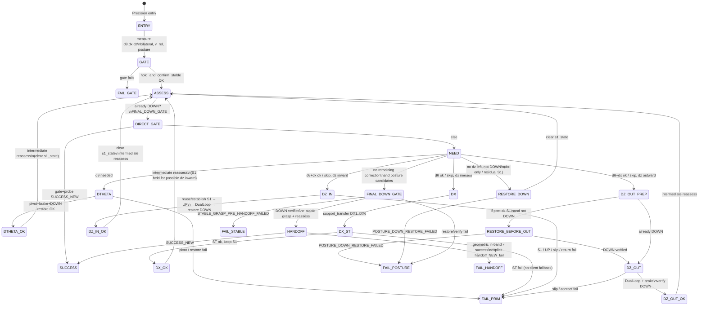
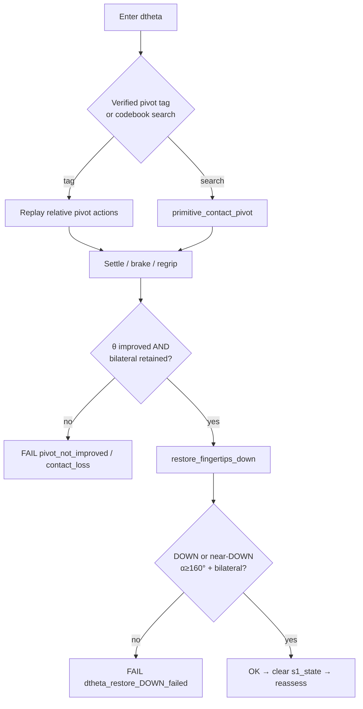
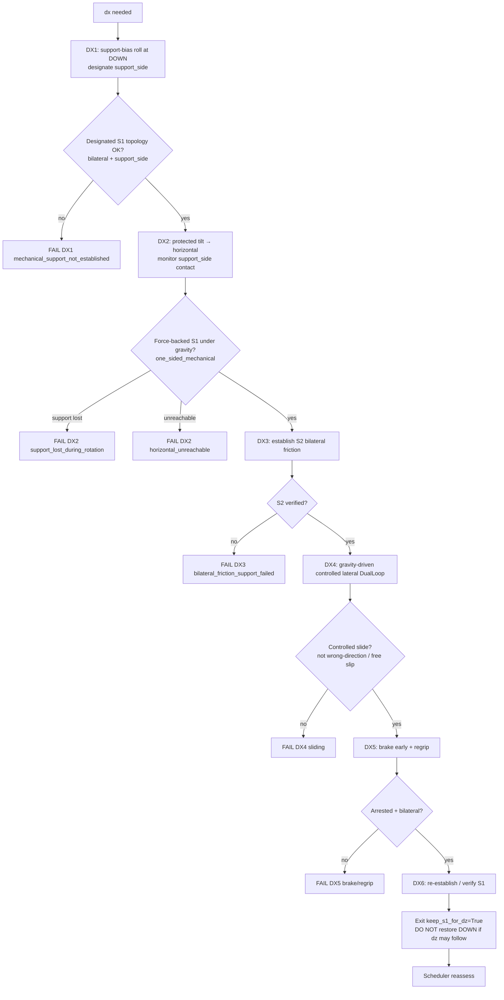
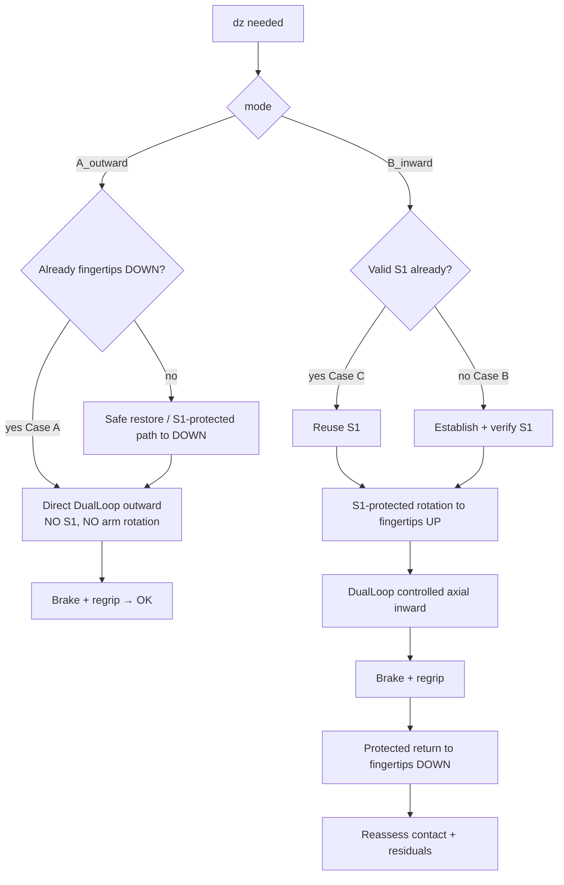
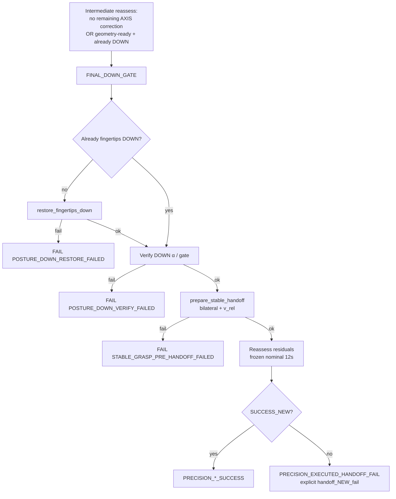

# Precision Oracle — Unified State-Machine Specification

**Authority:** This document is the contract for the CS5478 Stage-2 Precision Oracle.
It recovers the intended unified flowchart (dtheta → dx support-transfer → dz → posture → frozen HANDOFF)
from project design notes, `results/diagnostics/precision_oracle_unified_flow/`, and verified physical experiments.

It intentionally separates:

| Layer | Meaning |
|---|---|
| **Intended algorithm** | Original flowchart contract (this document) |
| **Current implementation** | What the code does today (see gap audit) |
| **Proposed changes** | Ordered repairs to restore the contract |
| **Physically verified** | Behaviors demonstrated in MuJoCo with force/contact evidence |

Do **not** reinterpret the algorithm from a single IC failure (e.g. `hard_910026` DX2).
Local `|dx|`/`|dz|` reduction is **not** completion. Completion requires correct transitions,
mechanically valid manipulation, and successful nominal continuation (`SUCCESS_NEW` / `SUCCESS_12S`).

---

## 1. Coordinate and measurement conventions

### 1.1 Signed residuals (hand frame)

Measured by `sample_state` / `measure_errors`:

| Symbol | Code | Meaning |
|---|---|---|
| \(e_x\) / `dx_mm` | `e_signed_mm[0]` | Lateral residual along hand \(+x\) (pad / lateral slide axis) |
| \(e_y\) / `dy_mm` | `e_signed_mm[1]` | Depth residual |
| \(e_z\) / `dz_mm` | `e_signed_mm[2]` | Axial residual along cylinder / open direction |
| \(\theta\) / `dtheta_deg` | `e_theta_deg` | Angular error vs target axis `U_TGT` |
| `e_pos_mm` | Euclidean \(\|e\|\) | Used by SUCCESS_NEW working band |

**AXIS_V1 readiness (geometry only, not HANDOFF success):**

- `|ex| ≤ 12 mm`, `|ey| ≤ 12 mm`, `|ez| ≤ 20 mm`, `|θ| ≤ 10°`

**SUCCESS_NEW (frozen definition — do not weaken):**

- `SUCCESS_12S` ∧ working hold: `θ ≤ 10°`, `e_pos ≤ 12 mm`, hold ≥ 0.5 s under nominal continuation.

Geometric in-band AXIS status **≠** successful nominal HANDOFF.

### 1.2 Posture (world)

| Gate | Definition |
|---|---|
| Fingertips **DOWN** | `u_open` ≈ world \(-Z\) (`alpha_up_deg` near 180°) |
| Fingertips **UP** | `u_open` ≈ world \(+Z\) (`alpha_up_deg` near 0°) |
| Horizontal working | `u_open` near horizontal (`alpha_up_deg` ≈ 90°) |

`DOWN = [0,0,-1]`, `UP = [0,0,+1]` in world. Wrist rates are body-frame; tilt projects roll out unless a roll phase is active.

### 1.3 Contact forces

| Quantity | Meaning |
|---|---|
| `fn_L` / `fn_R` | Pad normal force magnitudes |
| `Fn_z_L` / `Fn_z_R` | World-\(Z\) component of contact normal (load-bearing vs gravity) |
| `Ft_z_*` | Friction \(Z\) components |
| Bilateral | Both pads in contact with `fn ≥ 1` |
| **S1** `ONE_SIDED_MECHANICAL_SUPPORT` | Bilateral contact **and** one side carries dominant `Fn_z` (force-backed, not angle alone) |
| **S2** `BILATERAL_FRICTION_SUPPORT` | Balanced friction hold under near-horizontal open |

At pure fingertips-DOWN, `Fn_z` on both pads is often near zero by geometry (normals ≈ horizontal).
Therefore **force-backed S1 is verified under gravity during / after the protected tilt toward horizontal**,
not by orientation flags at DOWN alone. DX1 still must establish a **designated support side** and
a support-biased contact topology before DX2 proceeds.

### 1.4 Rotation / slide directions

- **Pivot (dtheta):** relative contact pivot about the grasp; preserve bilateral topology; brake before overshoot.
- **dx lateral desire:** `lateral_desire_direction` from signed `ex` (object-relative slip, not whole-hand world translation).
- **dz outward:** along `+u_open` (hand open / away from palm).
- **dz inward:** along `-u_open`.
- **Roll sign for S1:** `choose_roll_sign_for_support` selects which finger becomes the load-bearing side.

---

## 2. Intended global scheduler

### 2.0 Core invariant — mandatory fingertips-DOWN before final HANDOFF

Every **final** HANDOFF evaluation must occur only after:

1. Restoring fingertips vertically DOWN (if not already).
2. Verifying the DOWN posture.
3. Re-establishing stable grasp / contact.
4. Reassessing residual pose and relative velocity.

No dx or dz primitive may transition directly to final HANDOFF while the gripper remains in a **horizontal** or fingertips-**UP** working configuration.

**Intermediate reassessment** (after DX6, mid-dz, etc.) may observe geometric readiness without being HANDOFF-eligible. HANDOFF eligibility requires the `FINAL_DOWN_GATE`.

**Preserve S1 reuse:** do **not** force DOWN between DX6 and DZ inward.

### 2.1 Canonical sequences (all converge through FINAL_DOWN_GATE)

| Sequence | Steps |
|---|---|
| **DX → DZ inward (S1 reuse)** | DX1…DX6 → reuse S1 → DZ inward → restore DOWN → verify stable grasp → reassess → **FINAL_DOWN_GATE** → HANDOFF |
| **DX → DZ outward** | DX6 → **restore DOWN** → outward DualLoop → brake/regrip → verify DOWN → reassess → **FINAL_DOWN_GATE** → HANDOFF |
| **DX-only** | DX6 → **restore DOWN** → verify stable grasp → reassess → **FINAL_DOWN_GATE** → HANDOFF |
| **DZ-only inward** | establish S1 → rotate UP → inward slide → restore DOWN → verify stable grasp → reassess → **FINAL_DOWN_GATE** → HANDOFF |
| **DZ-only outward (already DOWN)** | direct outward slide → brake/regrip → verify DOWN → reassess → **FINAL_DOWN_GATE** → HANDOFF |

### 2.2 Global rules

1. **Priority order:** dtheta → dx → dz → final posture / physical validation.
2. Priority does **not** mean all three always execute. Skip branches when residuals are already within AXIS tolerances **and** physical gates allow.
3. After each completed correction, **intermediate reassess** residuals, contact, and posture.
4. **Never** equate AXIS in-band geometry with nominal HANDOFF success.
5. **Never** evaluate final HANDOFF from horizontal / UP working postures.
6. A failed HANDOFF probe / evaluation must report `PRECISION_EXECUTED_HANDOFF_FAIL` (or skip-fail), **not** `NO_REMAINING_CORRECTION` as if the task succeeded.
7. Explicit posture failures: `POSTURE_DOWN_RESTORE_FAILED`, `POSTURE_DOWN_VERIFY_FAILED`, `STABLE_GRASP_PRE_HANDOFF_FAILED`.
8. Do **not** silently invoke `correct_dx_verified` / legacy horizontal after support-transfer failure.
9. Do **not** modify Stage-1 B/C experts, GRPO checkpoints, M111 vocabulary, or training datasets / SUCCESS_* definitions.

---

## 3. dtheta (contact Pivot)

**Contract**

- Select a physically valid contact Pivot; preserve required contact topology.
- Control coupled translation during rotation; brake before overshoot; regrip and verify.
- **Mandatory** fingertips vertically DOWN (or accepted near-DOWN) after dtheta.
- Angular convergence alone is **not** success.

**Physically verified (prior experiments):** Relative pivot tags work when settle retains bilateral contact; restore / near-DOWN acceptance works when pivot does not drop the object. Plan A `0070` historically lost bilateral during settle (`dtheta:contact_loss`) — unresolved pivot-settle fragility, not a license to skip DOWN restore.

---

## 4. dx — Support transfer (DX1–DX6)

### 4.1 Phase contracts

| Phase | Intended | Guards |
|---|---|---|
| **DX1** | Establish mechanically meaningful single-sided **support bias** and **designate** `support_side`. At DOWN, full `Fn_z` asymmetry may not yet exist; topology + side designation are required. | Bilateral retained; `support_side` assigned; fail if roll loses contact. |
| **DX2** | Rotate arm to horizontal working configuration **while S1 protects the object**. | **Must not begin** without DX1 designation. Monitor **support-side** contact throughout (not “abort on any non-bilateral”). Verify `one_sided_mechanical` once gravity loads the support finger. Abort on support-side force collapse / latch / free fall. |
| **DX3** | Adjust gripper / roll to establish **S2** bilateral friction-bearing geometry. | `_score_horizontal_slide_config` + bilateral; fail closed. |
| **DX4** | Gravity-driven **controlled** lateral sliding (object-relative DualLoop). | Guard against uncontrolled slip; wrong-direction fail; early stop in tight `|dx|` band for dz recoverability. |
| **DX5** | Brake early and regrip. | `v_rel` arrested; bilateral. |
| **DX6** | Re-establish and verify S1 for possible **dz reuse**. | `make_s1_state` / live force check; `keep_s1_for_dz=True`. **Do not** restore DOWN between dx and dz when valid S1 can be reused. |

If dz is **skipped**, scheduler **must** still perform final posture restoration (`restore_DOWN_exit`) before HANDOFF.

### 4.2 Explicit non-goals

- Do **not** replace S1/S2 with an unrelated gravity-assist workaround that skips verified modes.
- Do **not** silently call `correct_dx_verified` after ST failure.
- Legacy `correct_dx_horizontal_attempt` / `correct_dx_verified` remain **experimental baselines** only when explicitly enabled in config — never silent substitutes.

**Physically verified:** Plan B `hard_910220` completed ST with force-verified S1 under DX2, S2, gravity lateral slide, DX6 S1 exit, and S1 reuse into inward dz (see unified_flow REPORT). HANDOFF `SUCCESS_NEW` may still fail on tight `e_pos` — that is a HANDOFF outcome, not ST success.

---

## 5. dz — Directional DualLoop

### 5.1 Outward

- If already DOWN: **no** S1 establishment, **no** arm rotation — DualLoop axial only.
- Else: restore required DOWN posture safely, then slide.
- Do not introduce unnecessary mechanical support transfers.

### 5.2 Inward

- Reuse valid S1 when present (especially post-dx DX6).
- Else establish and verify S1.
- S1-protected rotate to UP → DualLoop → brake → mechanically valid protected transition back to DOWN.
- Reassess after completion; clear `s1_state`.

**Physically verified:** Case A direct outward skips rotation; Case C S1 reuse after ST dx works on Plan B. Cold upright inward without prior S1 remains fragile (contact_loss on UP) — mark unresolved when it fails rather than inventing a new mechanism.

---

## 6. Final HANDOFF (`FINAL_DOWN_GATE`)

Before nominal handoff (mandatory):

1. Restore fingertips vertically DOWN if needed.
2. Verify DOWN posture.
3. Re-establish stable grasp / contact.
4. Reassess residual pose and relative velocity.
5. Execute **actual** frozen nominal continuation (not a geometry-only check).

`SUCCESS_NEW` and `SUCCESS_12S` use existing definitions. A failed HANDOFF must **not** be relabeled `NO_REMAINING_CORRECTION` success. In-band dx/dz residuals alone are **not** success.

---

## 7. S1 handoff contract (dx → dz)

| Event | `s1_state` |
|---|---|
| Successful dtheta (DOWN restore) | Cleared |
| Successful ST dx (DX6) | Set; `keep_s1_for_dz=True` |
| Scheduler chooses **dz inward** | **Reuse** S1 (no DOWN between DX6 and inward) |
| Scheduler chooses **dz outward** | **Restore DOWN first**, clear S1, then Case A DualLoop |
| Successful dz | Cleared (returns DOWN) |
| `restore_DOWN_exit` / `FINAL_DOWN_GATE` | Cleared |
| Failed primitive | Caller restores snapshot; do not pretend S1 valid |

---

## 8. Failure taxonomy (explicit reasons)

| Code / reason fragment | Meaning |
|---|---|
| `POSTURE_DOWN_RESTORE_FAILED` | Could not restore fingertips vertically DOWN before HANDOFF / outward |
| `POSTURE_DOWN_VERIFY_FAILED` | Post-restore posture still not DOWN |
| `STABLE_GRASP_PRE_HANDOFF_FAILED` | Stable bilateral / v_rel gate failed after DOWN |
| `mechanical_support_not_established` | DX1 could not designate / hold support topology |
| `support_lost_during_rotation` | DX2 lost support-side contact |
| `horizontal_unreachable` | DX2 did not reach working horizontal with S1 |
| `bilateral_friction_support_failed` | DX3 S2 failed |
| `sliding_did_not_occur` / `sliding_wrong_direction` | DX4 uncontrolled or wrong-way |
| `brake_could_not_arrest_slip` / `regrip_failed` | DX5 |
| `dz:contact_loss` / `DZ_UNSAFE_ENTRY` | Axial path unsafe |
| `handoff_NEW_fail:...` | Nominal continuation failed despite geometry attempts |
| `NO_REMAINING_CORRECTION` | Scheduler exhausted AXIS branches — **prelude to HANDOFF**, not success |

---

## 9. Proposed changes (ordered)

1. Explicit state / transition semantics in scheduler logs (`phases`, `cycle_row`, failure codes).
2. Force-backed / designated S1 before protected DX2; support-side monitoring during DX2.
3. Protected DX2 (no bilateral-only abort that contradicts S1).
4. S2 + controlled DX4 sliding guards (retain).
5. DX6 S1 re-establish + reuse into dz (retain; tighten `valid` to force-backed).
6. Correct dz outward/inward Case A–D (largely present).
7. dtheta DOWN restore (present; preserve).
8. Residual reassessment + HANDOFF status separation (present; keep `HANDOFF_FAIL` distinct).
9. **Remove silent legacy fallback** (`use_verified_lateral_fallback` default **False**).

---

## 10. Out of scope

- B/C Stage-1 experts, GRPO checkpoints, M111 vocabulary, training datasets.
- Redesigning the entire recovery stack.
- Weakening SUCCESS_NEW / SUCCESS_12S.
- Fabricating contact or force measurements in tests.

The gap-audit notes that accompanied earlier drafts of this specification are historical and live in `experiments/docs_historical/`. This file remains the behavior contract. Where an earlier "proposed change" has already landed in the scheduler, the source map below names the module that implements it.

## 11. Source modules

The scheduler in `data_generation/oracles/precision/state_machine.py` (`run_precision`) is the single authoritative transition order. It still owns `correct_dtheta`, which calls fingertips-DOWN restoration and does not reintroduce a silent legacy lateral fallback. Sibling modules own the skills it calls. Thresholds, phase order, and success flags are unchanged by the file move.

| Responsibility | Module |
|---|---|
| State-machine scheduling, dθ → dx → dz order, conditional skips, early/direct HANDOFF, frozen 12 s continuation | `data_generation/oracles/precision/state_machine.py` |
| `PrecisionConfig`, `PrecisionResult`, slip-goal and failure codes | `data_generation/oracles/precision/state.py` |
| Entry gate and residual classification (`entry_gate`, `assess_need`) | `data_generation/oracles/precision/entry_conditions.py` |
| Error measurement, handoff-geometry test, slip-goal stop test | `data_generation/oracles/precision/residuals.py` |
| Orientation-direction planning helpers | `data_generation/oracles/precision/corrections/orientation.py` |
| Lateral residual direction | `data_generation/oracles/precision/corrections/residual_directions.py` |
| Lateral dx attempt and verified horizontal correction | `data_generation/oracles/precision/corrections/lateral.py` |
| Contact-pivot primitives | `data_generation/oracles/precision/corrections/contact_primitives.py` |
| Axial sign and inward/outward mode choice | `data_generation/oracles/precision/corrections/axial_sign.py` |
| Inward dz, cold-start S1, DX6 S1 reuse, return-to-DOWN | `data_generation/oracles/precision/corrections/axial_inward.py` |
| Outward dz after fingertips-DOWN | `data_generation/oracles/precision/corrections/axial_outward.py` |
| Shared axial helpers (not a separate skill) | `data_generation/oracles/precision/corrections/axial_common.py` |
| DX support transfer and `restore_fingertips_down` | `data_generation/oracles/precision/mechanics/support_transfer.py` |
| Contact-mode classification and S1 state | `data_generation/oracles/precision/mechanics/support_verification.py` |
| Protected fixed-axis rotation, including to_UP brake-before-vertical | `data_generation/oracles/precision/mechanics/protected_rotation.py` |
| Coast distance, latched zero rate, contact-rate guard | `data_generation/oracles/precision/mechanics/rotation_braking.py` |
| Goal-aware and staged axial slip | `data_generation/oracles/precision/mechanics/axial_sliding.py` |
| DualLoop force and slip controllers | `data_generation/oracles/precision/mechanics/dual_loop.py` |
| Stable-grasp verification | `data_generation/oracles/precision/mechanics/grasp_stabilization.py` |
| Direct HANDOFF probe, `FINAL_DOWN_GATE`, stable-handoff preparation | `data_generation/oracles/precision/handoff.py` |
| Action/capture replay audit | `data_generation/oracles/precision/replay_audit.py` |
| Nominal HANDOFF continuation used by direct and final gates | `evaluation/handoff_from_state.py`, `evaluation/axis_aware_success.py` |

`SUCCESS_NEW` remains the expert-success flag inside `run_precision`. `SUCCESS_12S` is recorded separately and does not promote a trajectory whose status is `PRECISION_EXECUTED_HANDOFF_FAIL`.
